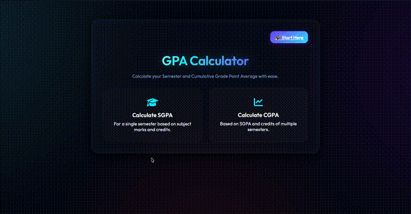

  

  
  
  

---

<h2 align="center">01 — SYSTEM PROFILE</h2>

<table align="center">
  <tr>
    <td align="center" valign="middle" width="180">
      
       
      <strong>Satyam Jha</strong>
       
      FULL-STACK DEVELOPER
    </td>
    <td align="center" valign="middle">
      <pre align="left">
USER        : Satyam Jha
ROLE        : Full-stack Developer
EDUCATION   : B.Tech — Computer Science & Engineering
BUILD MODE  : Learn → Build → Debug → Improve
INTERESTS   : Web Engineering · AI Integration · DSA
OBJECTIVE   : Build useful software, one project at a time.
      </pre>
    </td>
  </tr>
</table>

  I build web applications across the frontend, backend, and database layers. 
  I enjoy turning ideas into functional products while strengthening my 
  problem-solving and software engineering skills.

---

<h2 align="center">02 — TECH STACK</h2>

<table align="center" width="100%">
  <tr>
    <td width="50%" align="center" valign="middle">
      <strong>01 / FRONTEND</strong>
        
      
    </td>
    <td width="50%" align="center" valign="middle">
      <strong>02 / BACKEND</strong>
        
      
    </td>
  </tr>
  <tr>
    <td width="50%" align="center" valign="middle">
      <strong>03 / DATABASES</strong>
        
      
    </td>
    <td width="50%" align="center" valign="middle">
      <strong>04 / LANGUAGES & TOOLS</strong>
        
      
    </td>
  </tr>
</table>

---

<h2 align="center">🚀 Featured Projects</h2>

  <table>
    <tr>
      <td align="center" width="33%">
        
         <strong>WeDoWork</strong> 
        <a href="https://wedowork.vercel.app">Live Demo ↗</a>
      </td>
      <td align="center" width="33%">
        
         <strong>PharmaGuard</strong> 
        <a href="https://pharma-gaurd-six.vercel.app">Live Demo ↗</a>
      </td>
      <td align="center" width="33%">
        
         <strong>GPA Calculator</strong> 
        <a href="https://gpa-calculator-m53d.onrender.com">Live Demo ↗</a>
      </td>
    </tr>
  </table>

  🌐 <a href="https://satyamjha-dev.netlify.app">Portfolio</a>

---

## 🔥 GitHub Streak

  

---

## 🌐 Connect With Me

  
  &nbsp;
  
  &nbsp;
  
  &nbsp;
  

  <a href="mailto:satyam.jha.coder@gmail.com">satyam.jha.coder@gmail.com</a>

  

---

  <i>💡 Small consistent improvements compound into extraordinary results.</i>

